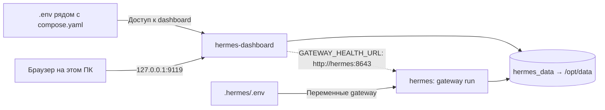

# 🪽 Hermes в Docker — зачем эта папка и как ей пользоваться

> **Коротко:** `compose.yaml` — рецепт запуска отдельного Hermes в контейнерах:
> фонового **gateway** и **веб-панели управления**. Он нужен для серверного
> или экспериментального окружения, а не для запуска Python-конвейера MultiAgents.

| Компонент | Для чего |
|:--|:--|
| 🧠 **Gateway** | Фоновая работа Hermes и подключённых интеграций; API при включённом API-сервере |
| 🖥️ **Dashboard** | Управление Hermes через браузер: настройки, сессии, логи и другие функции панели |
| 💾 **Docker volume** | Постоянные данные контейнерного экземпляра |
| 🔐 **Приватные `.env`** | Секреты и параметры запуска, которые нельзя публиковать в Git |

## 🧭 Откуда появился `compose.yaml`

Файл пришёл из удалённой истории репозитория в коммите:

```text
c6619a1 feat(hermes): добавить конфигурацию Hermes Agent и скрипт поиска по sqlite
```

Из содержимого видно его назначение: поднять gateway и dashboard с общим
хранилищем. Личную мотивацию автора этот файл не объясняет.

Позже в `bdd3985` исправлена безопасность: убраны фиксированные учётные данные,
добавлены обязательные подстановки из окружения и localhost-привязка dashboard.

> [!NOTE]
> **Это отдельный экземпляр Hermes.** Текущее desktop-приложение Windows
> не начинает использовать эти контейнеры автоматически. Его профиль, память,
> навыки и настройки не копируются в Docker простым наличием этой папки.

## 🏗️ Как устроена конфигурация



Это схема объявленных связей, а не подтверждение, что контейнеры уже запущены.

### Сервисы и порты

| Сервис Compose | Имя контейнера | Команда | Публикация порта |
|:--|:--|:--|:--|
| `hermes` | `hermes` | `gateway run` | `8643:8643` |
| `hermes-dashboard` | `hermes_dashboard` | `dashboard --host 0.0.0.0 --port 9119` | `127.0.0.1:9119:9119` |

Оба сервиса используют `nousresearch/hermes-agent:latest` и политику
`restart: unless-stopped`. Она работает при работающем Docker Engine;
сам запуск Docker Desktop вместе с Windows настраивается отдельно.

> [!IMPORTANT]
> Проброс `8643:8643` **не включает API-сервер сам по себе**.
> Для этой схемы gateway должен действительно слушать **8643 внутри контейнера**.
> В актуальной документации Hermes стандартный пример использует 8642,
> поэтому порт этой конкретной конфигурации нужно задать явно.
>
> `depends_on` задаёт порядок запуска, но здесь нет `healthcheck` и условия
> ожидания готовности gateway. Состояние `running` ещё не доказывает исправность API.

## 📁 Что лежит в папке

```text
Hermes-project/
├── compose.yaml                # Рецепт Docker-окружения
├── README.md                   # Эта инструкция
├── .env.example                # Пустой пример параметров dashboard
├── .env                        # Твои секреты dashboard — не в Git
├── .hermes/
│   ├── .env                    # Переменные gateway — не в Git
│   └── SOUL.md                 # Файл личности, сохранённый в репозитории
└── sqlite3-search-data.py       # Отдельный скрипт просмотра executions.db
```

**Файлы `.env` нужно подготовить локально:** они намеренно не хранятся в Git.

### Почему `.env` два?

| Файл | Кто читает | Что в нём |
|:--|:--|:--|
| `.env` рядом с `compose.yaml` | Docker Compose для подстановок `${...}` | Имя пользователя, пароль и секрет dashboard |
| `.hermes/.env` | Compose через `env_file` сервиса `hermes` | Переменные gateway: API, провайдеры и интеграции |

Это разные механизмы. `env_file` внутри сервиса **не делает его значения
источником подстановок для остальных сервисов**. Переменные процесса также
могут участвовать в подстановках Compose.

## 🚀 Первый запуск

### 1. Подготовь Docker

Нужны Docker Engine и Docker Compose. На Windows обычно используется
Docker Desktop с Linux-контейнерами.

```powershell
cd C:\Work\Source-NSU\ML\Hermes-project
docker compose version
```

### 2. Создай приватную конфигурацию dashboard

```powershell
# Не перезаписываем уже существующий файл с секретами.
if (-not (Test-Path .env)) {
    Copy-Item .env.example .env
}
```

Открой `.env` в редакторе и заполни:

```dotenv
HERMES_DASHBOARD_BASIC_AUTH_USERNAME=admin
HERMES_DASHBOARD_BASIC_AUTH_PASSWORD=
HERMES_DASHBOARD_BASIC_AUTH_SECRET=
```

- **PASSWORD** — новый стойкий пароль для входа в панель.
- **SECRET** — отдельный случайный секрет подписи сессий, не тот же пароль.
- Пустые пароль и секрет оставлены в примере намеренно: без них Compose
  остановится с понятной ошибкой.

Не вставляй настоящие значения в README, коммиты, скриншоты или переписку.

### 3. Подготовь переменные gateway

Создай `.hermes/.env`. Для согласования API с текущим `compose.yaml`
нужны следующие параметры:

```dotenv
API_SERVER_ENABLED=true
API_SERVER_PORT=8643
```

Настройки модели, провайдера и интеграций зависят от твоего окружения.
**`compose.yaml` не содержит готовой конфигурации LLM.**

Для первичной настройки Hermes можно использовать мастер в одноразовом
контейнере с тем же volume:

```powershell
docker compose run --rm hermes setup
```

До этой команды оба приватных файла окружения уже должны быть подготовлены.
Настройки, сохранённые мастером внутри `/opt/data`, останутся в Docker volume.

### 4. Проверь конфигурацию и запусти

```powershell
# Проверяет Compose-файл и подстановки, но не доступность LLM или API.
docker compose config --quiet

# Скачивает образ при необходимости и запускает сервисы в фоне.
docker compose up -d

# Проверяем состояние и затем логи.
docker compose ps
docker compose logs --tail 100 hermes hermes-dashboard
```

Открой **http://127.0.0.1:9119** и используй учётные данные из `.env`.
Не публикуй вывод логов без проверки на секреты и персональные данные.

> [!WARNING]
> Здесь описан порядок запуска, **но полный Docker-запуск этой конфигурации
> в рамках подготовки README не выполнялся**. Проверка синтаксиса Compose
> не заменяет проверку образа, авторизации, модели и доступности gateway.

## 💾 Где сохраняются данные

Оба контейнера монтируют **именованный Docker volume `hermes_data` в `/opt/data`**.
Фактическое имя volume может содержать префикс Compose-проекта.

Официальный образ использует `/opt/data` для постоянного состояния Hermes.
Удаление и пересоздание контейнера не равнозначно удалению volume.
Логи в этой конфигурации дополнительно направляются в `/opt/data/logs`.

> [!IMPORTANT]
> Локальная папка `.hermes/` **не смонтирована целиком**. В частности,
> лежащий в ней `SOUL.md` не попадёт в контейнер автоматически.
> Сейчас с хоста считывается только `.hermes/.env` как набор переменных gateway.
> Для применения файлов личности или настроек их нужно отдельно перенести
> в соответствующий каталог контейнерного профиля.

Не запускай второй gateway того же профиля поверх этого же хранилища.
Резервная копия должна охватывать volume и приватную конфигурацию; выполняй
согласованное резервирование SQLite, а не копирование отдельных файлов
активной базы без её WAL-состояния.

## 🛠️ Команды на каждый день

Все команды ниже выполняются из `Hermes-project`.

| Задача | Команда |
|:--|:--|
| Статус сервисов | `docker compose ps` |
| Смотреть логи | `docker compose logs -f --tail 100` |
| Остановить контейнеры | `docker compose stop` |
| Запустить остановленные | `docker compose start` |
| Применить изменённые параметры окружения | `docker compose up -d` |
| Остановить и удалить контейнеры/сеть, сохранив именованный volume | `docker compose down` |
| Получить свежий образ | `docker compose pull` |
| Пересоздать сервисы после обновления | `docker compose up -d` |

> [!CAUTION]
> **Не добавляй `-v` к `docker compose down`, если хочешь сохранить данные:**
> этот флаг удаляет объявленные именованные volumes.
> Перед обновлением делай резервную копию. Тег `latest` изменяемый — для
> воспроизводимого окружения лучше отдельно согласовать закрепление версии
> или digest образа.

## 🔎 Для чего `sqlite3-search-data.py`

Это самостоятельный диагностический скрипт. Он открывает **`executions.db`
из текущего рабочего каталога**, выводит список таблиц и до 1000 записей из
`executions` и `cron_incidents`.

- Compose его не запускает.
- Он не подключается к volume и не ищет базу автоматически.
- Нужна база с ожидаемой схемой: это не универсальный просмотрщик SQLite.
- При отсутствии файла `sqlite3.connect()` создаст пустую базу, после чего
  запросы к отсутствующим таблицам завершатся ошибкой. Не запускай его
  в случайной папке в надежде, что он найдёт данные контейнера.
- Эта база может содержать тексты ошибок и служебные сведения — не публикуй
  её содержимое без проверки.

## 🔐 Безопасность

- Dashboard опубликован **только на localhost**, но его контейнер слушает
  `0.0.0.0` для приёма соединений через Docker.
- Gateway опубликован как `8643:8643` **без ограничения localhost**.
  Оцени правила firewall и авторизацию API; не считай его приватным автоматически.
- Basic Auth не заменяет HTTPS. Для внешнего доступа нужны отдельно
  спроектированные VPN/HTTPS и контроль доступа; не открывай панель в интернет
  простой заменой `127.0.0.1` на `0.0.0.0`.
- `.env` и `.hermes/.env` исключены из Git; `.env.example` содержит только шаблон.
- В старой версии Compose были фиксированные пароль и секрет. Если они
  использовались, **замени оба**. История Git по-прежнему содержит старые значения.
- Этот README не выполняет ротацию секретов и не меняет уже запущенные контейнеры.

## 🧩 Если что-то не работает

| Симптом | Что проверить |
|:--|:--|
| `Set dashboard password/secret in private .env` | Заполнен ли `.env`; не подставляет ли окружение процесса пустое значение |
| Не найден `.hermes/.env` | Создан ли отдельный файл gateway относительно `compose.yaml` |
| Панель не открывается | Работает ли Docker, статус сервиса, конфликт порта 9119, логи |
| Панель не видит gateway | Включён ли API, слушает ли он 8643, соответствует ли авторизация требованиям API |
| Изменил `SOUL.md`, а поведение не поменялось | Этот локальный файл не смонтирован в контейнер |
| Скрипт SQLite пишет `no such table` | Открыта другая/пустая база или её схема отличается |

## 📚 Официальные материалы

- [Hermes: запуск в Docker](https://hermes-agent.nousresearch.com/docs/user-guide/docker)
- [Hermes: веб-панель](https://hermes-agent.nousresearch.com/docs/user-guide/features/web-dashboard)
- [Docker Compose: подстановка переменных](https://docs.docker.com/compose/how-tos/environment-variables/variable-interpolation/)
- [Docker Compose: volumes](https://docs.docker.com/engine/storage/volumes/)

---

**Итог:** папка хранит инфраструктурный рецепт отдельного Hermes.
Для обычной работы `MultiAgents/main.py` запускать этот Docker-стек не требуется.
